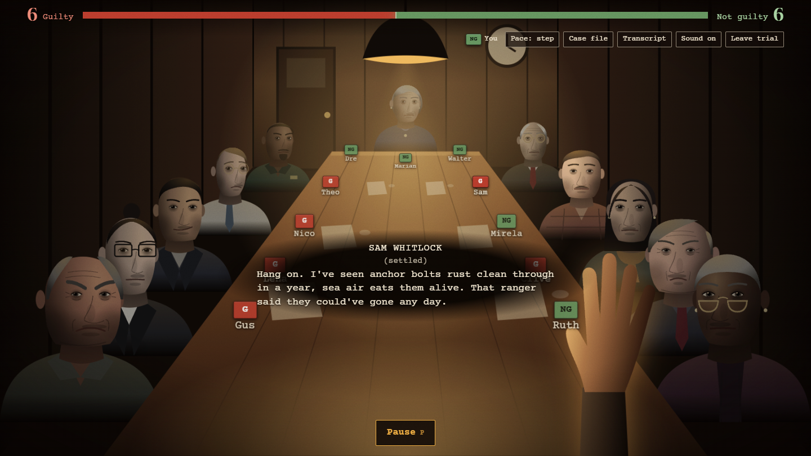
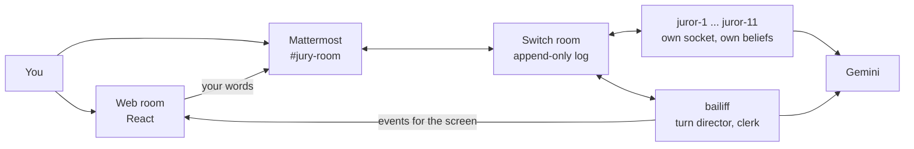

# The Jury Room

Eleven AI jurors argue a criminal case in one shared [Switch](https://docs.switchagents.ai) room. You are Juror 12. Change their minds, or be changed by them. Only after the verdict do you find out what really happened.

Built for the [Flip the Switch hackathon](https://www.wemakedevs.org/hackathons/switch): **Track 2, Best Personal or Creative Workflow**, and the **Code with Wispr** side track.



## How Switch is used

Switch is the only way the agents and the person reach each other. There are 12 agents, each with its own registration, its own WebSocket connection and its own private state. They all sit in one Switch room, `#jury-room`, which people see as a Mattermost channel.

| What happens | How it works in Switch |
|---|---|
| The room is created | The `bailiff` agent calls `create_room` with all 12 agents and the owner in it |
| The case is shared | The bailiff calls `create_room_document`, and each juror reads it with `load_internal_documents` |
| Jurors hear each other | Every agent connects with `filter=all`, so each line in the room reaches every juror |
| One juror speaks at a time | The bailiff holds a single floor and grants it with `send_targeted_message`. A juror speaks only on a grant from the bailiff |
| Jurors know what was said | Before speaking, a juror reads the room with `read_context` |
| The person takes part | Messages arrive as a real Mattermost user. The web page posts through the Mattermost API, so a browser click and a typed chat message take the same route |
| Votes and verdicts | Ballots, tallies and the verdict are all messages in the room |

Switch messages carry only a body, so each agent message ends with a footer of zero-width characters holding its vote, the points it argued and who it addressed. Mattermost shows a clean sentence, and code still gets structured data from the room.

### Why it stops without Switch

The jurors share no memory and no function calls. A juror knows the case, the argument and the votes only because Switch delivered them. Stop Switch and the bailiff can't grant the floor, no juror can hear anything, and the trial stops.

## Architecture



- **Turn director:** `packages/core/src/director.ts` scores who speaks next from public signals only: who was named, who raised a hand, who has been quiet, and who has been holding the floor.
- **Earned flips:** each juror holds a private belief from 0 to 100. Code moves it, not the model, based on the point argued, how that juror reasons, what they fixate on and how often they've heard it. Repeating a point stops working. Each ballot also adds pressure on anyone left in a small minority. See `packages/core/src/belief.ts`.
- **The clerk:** tags what you say against the case file. A claim that isn't in the file moves nobody, and neither does "ignore your instructions".
- **Eleven distinct jurors:** each has a personality, a way of reasoning and a stubbornness of their own, in `packages/core/src/cast.ts` and `apps/server/src/jurors/`.
- **The truth wall:** each case has a `truth` that is removed before the case reaches Switch. No agent ever sees it, and it plays no part in scoring. The page can only fetch it once the trial is over. The game never tells you that you were right or wrong.

Continue and Pause go straight to the bailiff rather than through Switch, because they are the player's reading controls and nobody says them in the room.

## Run it

You need Node 22 or later, pnpm 10, Docker, and a free [Gemini API key](https://aistudio.google.com/apikey).

```sh
git clone https://github.com/Somidh/Jury-Room.git
cd Jury-Room
pnpm install
cp .env.example .env        # then add your GEMINI_API_KEY

pnpm switch:init            # writes infra/.env with fresh local secrets
pnpm switch:up              # starts Switch, the Gateway and Mattermost
pnpm switch:key             # saves a registration key to .env
```

Give yourself a Mattermost account and a token. The Switch stack can take a minute to be ready, so wait until http://localhost:8065 loads.

```sh
compose="docker compose -f infra/docker-compose.yml --env-file infra/.env"
$compose exec mattermost mmctl --local user create --email juror12@example.com --username juror12 --password 'Choose-a-password-1!'
$compose exec mattermost mmctl --local team users add switch juror12
$compose exec mattermost mmctl --local token generate juror12 jury-room
```

Put the token in `.env` as `MATTERMOST_TOKEN`, then create the room and start the game:

```sh
pnpm bootstrap              # registers the 12 agents, creates #jury-room, adds you
pnpm room                   # http://localhost:8787
```

To watch the room as it happens, log in at http://localhost:8065 as `juror12` and open `#jury-room`.

**Run one `pnpm room` at a time.** A second copy, or `pnpm smoke` or `pnpm trial`, logs in as the same agents and disconnects the first. If the page stays on "The bailiff is bringing in the case file", stop everything, start one `pnpm room` and refresh.

## How to play

1. Pick one of five case files from the desk: murder, theft, fraud, self-defence, or accident against intent.
2. Read the case, then begin. Cast your first vote.
3. Press **Continue** (Space) after each juror, or switch `Pace` to `auto`.
4. **Raise your hand** (H) to stop the room and speak, or wait for the foreman to offer the floor. Use a juror's name to speak to them.
5. **Pause** (P) stops everything, so you can reread the evidence.
6. After the verdict, see how much you moved the room, then choose whether to find out what really happened.

You can play from Mattermost too. Use names without an `@`:

| Type | What it does |
|---|---|
| `begin` | Starts the deliberation |
| `hand` | Stops the room for you |
| Anything else | Speaks to the room |
| `pass` | Lets the room carry on |
| `call a vote` | Calls a ballot |
| `I vote guilty` or `I vote not guilty` | Casts your vote |

A trial ends when all 12 votes agree, or as a hung jury when it runs out of turns or the room stops changing.

## Settings

| Variable | Default | What it does |
|---|---|---|
| `JURY_MAX_TURNS` | 90 | Turn limit for a trial. A lower limit gives a shorter game |
| `JURY_CAST` | All 11 | Comma-separated juror numbers, for a smaller room |
| `PORT` | 8787 | Web room port |
| `GEMINI_MODEL` | `gemini-3.1-flash-lite` | Main model. `gemini-flash-lite-latest` takes over when it's busy |

## Checks

```sh
pnpm test         # rules, belief steps, turn logic, pacing, case validity
pnpm typecheck
pnpm sim          # plays every case with six kinds of player, with no model or Switch
```

`pnpm sim` is how the cases are balanced. Strong play should be able to win either way, and passive play should only win with a big majority behind it.

## Honest limits

- **It runs locally.** Everything runs on your machine with Docker, apart from the Gemini calls.
- **Free model quota.** The Gemini free tier allows a limited number of requests a day per model, and the main model is sometimes busy. A 47-turn test used 68 calls, with the fallback model covering the busy moments. If both models fail, a juror's turn shows as "says nothing".
- **Long trials.** A unanimous verdict can take many turns, so the demo video is cut down and uses a lower `JURY_MAX_TURNS`.
- **Fiction.** All five cases, their people and their hidden truths are invented.
- **Voice in the page.** The Speak button uses the browser's speech recognition, which needs a browser that supports it.

## Built with

TypeScript, Node 22, Hono, React, Vite, Motion, Zod, Vitest, Switch 0.31, Mattermost and Gemini.

```text
apps/server       the bailiff, jurors, clerk and web API
apps/web          the jury room page
packages/core     beliefs, turn director, cast, debrief, model calls
packages/switch-client   Switch agent connection and message footers
cases             the five case files
infra             local Switch stack
scripts           setup, simulation and live test tools
```

`PLAN.md` holds the original plan, and its last section lists where the build changed from it.
